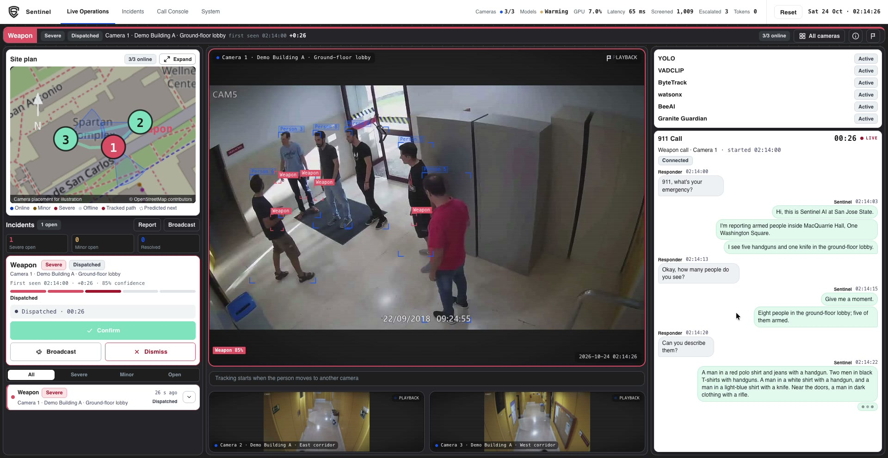
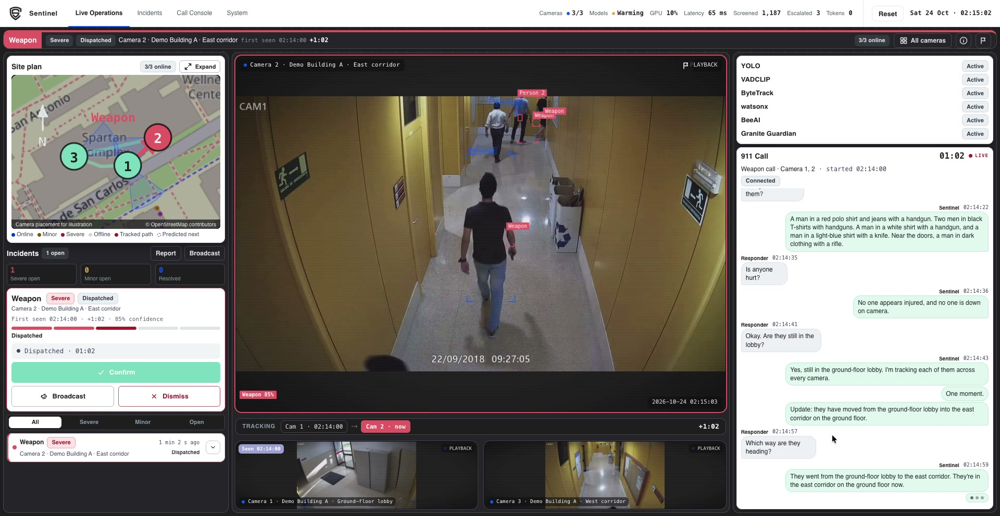
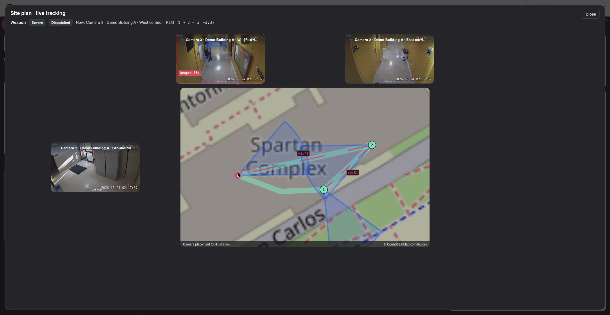
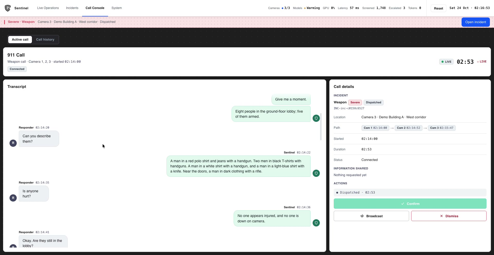
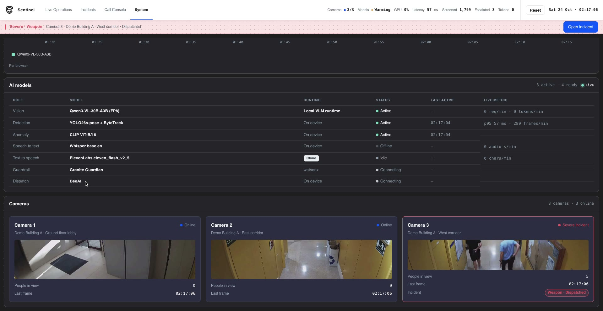
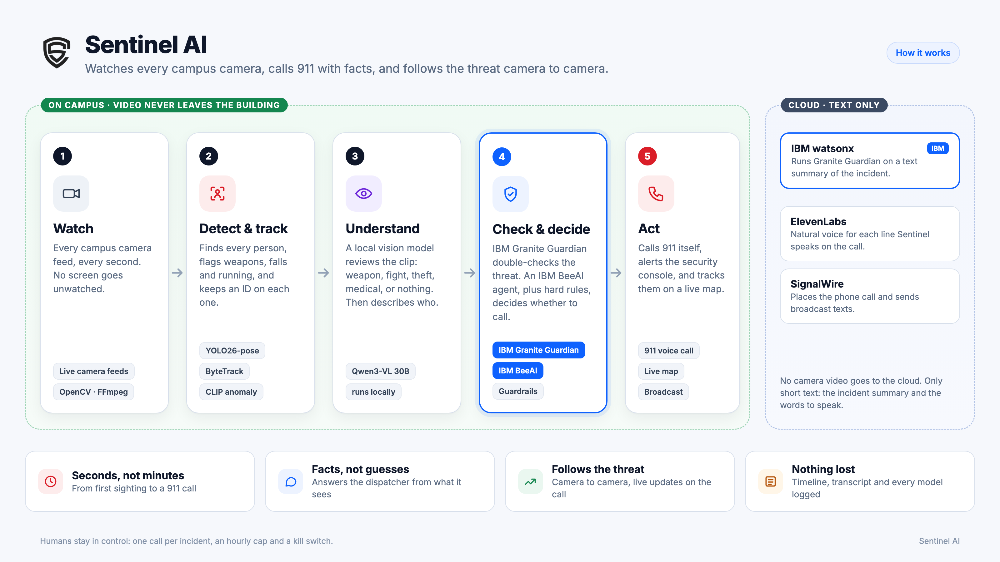
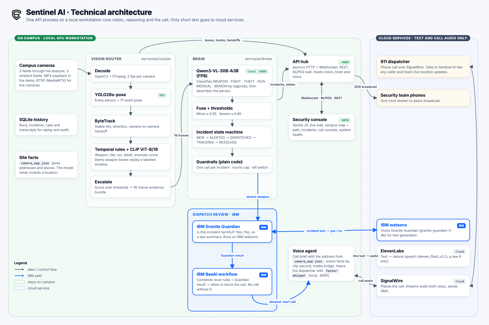
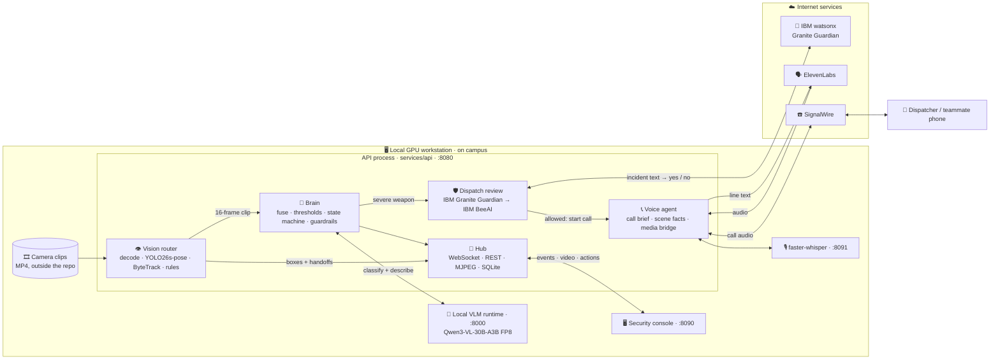

<p align="center">
  <picture>
    <source media="(prefers-color-scheme: dark)" srcset="web/assets/logo-inverse.png">
    
  </picture>
</p>

<h1 align="center">Sentinel AI</h1>

<p align="center">
  <b>AI that watches every campus camera, calls 911 with facts it can see, and follows the threat camera to camera.</b>
</p>

<p align="center">
  
  
  
  <br>
  
  
  
  
  
</p>

<p align="center">
  <a href="#-demo">Demo</a> ·
  <a href="#-the-problem">Problem</a> ·
  <a href="#-what-sentinel-ai-does">What it does</a> ·
  <a href="#-how-ibm-fits-in">IBM</a> ·
  <a href="#-privacy-first">Privacy</a> ·
  <a href="#-a-day-with-sentinel-ai">Story</a> ·
  <a href="#-results">Results</a> ·
  <a href="#-the-team">Team</a> ·
  <a href="#%EF%B8%8F-for-developers">For developers</a>
</p>

---

## 🎬 Demo

> 📺 **Demo video:** coming soon on our Devpost page. <!-- TODO: replace with the Devpost or YouTube link -->

<p align="center">
  
  <br><sub><b>Live Operations.</b> A weapon in the ground-floor lobby. Every person is boxed, the armed ones in red, and Sentinel AI is already on a 911 call (right).</sub>
</p>

<table>
  <tr>
    <td width="50%"></td>
    <td width="50%"></td>
  </tr>
  <tr>
    <td><sub><b>Camera to camera.</b> They move into the east corridor. The map, the tracking strip and the call all update together.</sub></td>
    <td><sub><b>Live tracking.</b> Every handoff extends the red path, so responders know where they are and where they're going.</sub></td>
  </tr>
  <tr>
    <td width="50%"></td>
    <td width="50%"></td>
  </tr>
  <tr>
    <td><sub><b>Call Console.</b> Every word of the call, next to the incident and its camera path.</sub></td>
    <td><sub><b>System.</b> Every model, where it runs, and what it's doing right now.</sub></td>
  </tr>
</table>

---

## 🤔 The problem

**Cameras record everything. Humans can't watch everything.**

Think about a campus at night. A fight breaks out behind the library. Someone walks into a building with a weapon. A student collapses in an empty stairwell. Almost every one of those moments is on camera. Yet almost every time, **nobody sees it until it's too late**. The footage becomes evidence *after* the fact, not help *during* it.

The problem isn't a lack of cameras. It's a lack of eyes.

<table>
  <tr>
    <td align="center" width="33%"><h2>23,400</h2>on-campus crimes reported at U.S. colleges in 2021</td>
    <td align="center" width="33%"><h2>2.1</h2>sworn officers for every 1,000 students</td>
    <td align="center" width="33%"><h2>93%</h2>of public schools already use security cameras</td>
  </tr>
</table>

<sub>Sources: NCES, <i>Criminal Incidents at Postsecondary Institutions</i> (2021) · BJS, <i>Campus Law Enforcement Agencies Serving 4-year Institutions, 2021–22</i> · NCES, <i>School Survey on Crime and Safety, 2021–22</i>.</sub>

A handful of officers can't watch hundreds of screens around the clock. So most cameras are just recording, and nobody is looking.

---

## 💡 What Sentinel AI does

Sentinel AI is like **a security guard who never blinks and can watch every camera at once**.

<p align="center">
  
</p>

1. **Watch.** Every camera feed, every second.
2. **Detect and track.** YOLO finds every person, ByteTrack keeps an ID on each one, and simple rules flag weapons, falls and running.
3. **Understand.** A local vision model (Qwen3-VL) reviews a short clip, names what's happening (weapon, fight, theft, running, medical, or nothing), and describes the people involved.
4. **Check and decide.** For a severe weapon incident, **IBM Granite Guardian** on **IBM watsonx** checks the threat, and an **IBM BeeAI** workflow combines that verdict with hard rules to allow or block the call.
5. **Act.** Sentinel AI raises an alert on the security console, **follows the person from camera to camera** on a live campus map, and **phones for help by itself**. On the call it answers the dispatcher's questions using only facts the cameras show, and gives live updates as they move.

---

## ✨ Key features

| | Feature | What this means for you |
|:---:|---|---|
| 👁️ | **Watches every camera, all the time** | No feed goes unwatched, even at 3 a.m. |
| 🧠 | **Understands what it sees** | It tells a weapon from a fight, a theft, someone running, or a medical emergency, instead of just reacting to movement. |
| 🛡️ | **IBM-checked before it acts** | IBM Granite Guardian double-checks the threat, and an IBM BeeAI workflow decides whether a call is allowed. |
| 🧭 | **Follows the person across cameras** | When someone moves from the lobby to a hallway, the alert, the map and the call move with them. |
| 📞 | **Calls for help by itself** | It places one call and answers questions like "How many people?", "What weapons?" and "Where are they now?" in a natural voice. |
| ✅ | **Facts, not guesses** | Addresses come from a fixed camera map, never from the AI. Counts and weapons come from what the camera sees at that second. If it doesn't know, it says so. |
| 📢 | **One-click broadcast** | Officers can send a shelter-in-place message to the security team from the console. |
| 🗂️ | **Nothing is lost** | The incident timeline, the full call transcript, and every model's activity and token use are recorded. |
| 🛑 | **Humans stay in control** | One call per incident, an hourly cap, and a kill switch. Officers can confirm or dismiss any incident. |

---

## 🔷 How IBM fits in

We used IBM tools where they carry weight: the moment before Sentinel AI does something outside the building.

| IBM tool | Job in Sentinel AI | Where |
|---|---|---|
| **IBM Granite Guardian** (`ibm/granite-guardian-3-8b`) | Reads a short text summary of the incident and answers one question: *is this harmful?* An independent safety check on top of the vision model. | `services/brain/track_ai.py` |
| **IBM watsonx** | Hosts Granite Guardian through the watsonx text-generation API (IAM token, project-scoped). Only the incident text is sent, never video. | `services/brain/track_ai.py` |
| **IBM BeeAI** (`beeai_framework` workflow) | Combines the local rules (severity, one call per incident, hourly cap, kill switch) with Guardian's verdict, and allows or blocks the call. **If Guardian or BeeAI fails, the call is blocked, not allowed.** | `services/brain/track_ai.py` → `services/api/hub.py` |
| **IBM Bob** | Our design partner while planning: it shaped the tiered pipeline, the calibrated-confidence approach and the safety gate. See [Use of AI](#-use-of-ai). | — |

The **System** page and the model panel show Guardian and BeeAI status live. Every decision is printed to the server log as `[track] guardian … beeai …`.

---

## 🔒 Privacy first

Most "smart camera" services upload your video to the cloud and analyze it there. **Sentinel AI does the opposite: it moves the computer to the video, not the video to the computer.**

**What stays on campus, on one local GPU workstation:**
- 📹 Every camera frame, and every image the AI looks at
- 🧠 The vision model's reasoning, the rules, and the BeeAI decision
- 👂 Understanding what the dispatcher says on the phone (speech recognition)
- 🗂️ The incident history

**What goes over the internet, and only when there is an incident:**
- 🛡️ **To IBM watsonx:** a short **text** summary of the incident for Granite Guardian, for example *"Campus camera incident on cam-01. A person is carrying a visible weapon."* No video and no images.
- 🗣️ **To ElevenLabs:** the **text** of each sentence Sentinel AI says on the call. ElevenLabs sends back the spoken audio.
- 📞 **To SignalWire:** the **phone call audio** in both directions, and the text of any SOS broadcast.

**What Sentinel AI never does:** no face recognition, no identity database, no matching against student lists. It only describes what a person looks like, for example "a man in a red polo shirt and jeans".

---

## 📖 A day with Sentinel AI

> *Our demo uses a staged "mock attack" recording played through three synchronized cameras. In live mode, calls go to a verified teammate's phone, **never to 911 or emergency services**. The demo video uses recording mode, described [below](#what-is-live-in-the-demo-and-what-is-pre-computed).*

**02:13:59.** Three cameras show a quiet building. Nothing is happening, and Sentinel AI keeps watching.

**02:14:00.** Armed people walk into the **ground-floor lobby (Camera 1)**. Every person gets a box, and the armed ones turn red. **Weapon, Severe.** A red alert appears on the security console, and the call starts:

> 👮 *"911, what's your emergency?"*
>
> 🤖 *"Hi, this is Sentinel AI at San Jose State. I'm reporting armed people inside MacQuarrie Hall, One Washington Square. I see five handguns and one knife in the ground-floor lobby."*
>
> 👮 *"Okay, how many people do you see?"*
>
> 🤖 *"Give me a moment. Eight people in the ground-floor lobby; five of them armed."*

**02:14:52.** They move into the **east corridor (Camera 2)**. Sentinel AI follows. The map extends the red path, and the **same call** gets an update: *"Update: they have moved from the ground-floor lobby into the east corridor on the ground floor."*

**02:15:47.** They reach the **west corridor near the stairwell (Camera 3)**. Same incident, same call, updated live.

**One detection. One call. Every handoff reported. No human had to notice first.**

```mermaid
sequenceDiagram
    autonumber
    participant Cam as 📹 Camera 1
    participant Eye as 👁️ YOLO + ByteTrack
    participant Brain as 🧠 Qwen3-VL
    participant GG as 🛡️ IBM Granite Guardian
    participant Bee as 🐝 IBM BeeAI
    participant Screen as 🖥️ Security console
    participant Voice as 📞 Voice agent
    participant Disp as 👮 Dispatcher

    Cam->>Eye: Live video frames
    Eye->>Eye: Finds people and follows each one
    Eye->>Brain: Something looks wrong: a 16-frame clip
    Brain->>Screen: 🚨 WEAPON, severe, with a description
    Brain->>GG: Incident summary (text only)
    GG->>Bee: Harmful? Yes
    Bee->>Voice: Rules + Guardian agree: place ONE call
    Voice->>Disp: Armed people in the ground-floor lobby
    Disp->>Voice: How many people do you see?
    Voice->>Disp: Eight people; five of them armed
    Cam-->>Eye: Group now on Camera 2
    Eye->>Screen: Map extends the path
    Screen->>Voice: Same call, location updated
    Voice->>Disp: They moved into the east corridor
```

---

## 📊 Results

These are real measurements from the local demo workstation (sample data in [`bench/`](./bench/)).

| What we measured | Result |
|---|---|
| 🎥 Live camera wall with detection boxes | **13–14 frames per second** (up from about 3) |
| 🗣️ ElevenLabs voice: time until the first sound is ready (short line, warm connection) | **157–160 milliseconds** |
| 🧠 Vision model size | **30 billion parameters**, but only about **3 billion** are active at each step. That keeps it fast on one GPU. |
| 🎯 Weapon labels lined up with the demo video | **640 of 649** frames matched |

> **Honest note:** we have not measured detection accuracy yet. The alert thresholds are demo settings, not tuned on labelled data (see [`bench/thresholds.json`](./bench/thresholds.json)).

---

## 👥 The team

Built for **SpartHill Hacks 2026** by **Ayush · Naman · Rahil · Vraj**.

---

## 🤖 Use of AI

**Inside the product**, each model has one job. Fast detectors screen every frame, a local vision model reasons only about escalated moments, IBM Granite Guardian gives an independent safety check, and an IBM BeeAI workflow plus plain-code guardrails decide whether to call. The model never decides alone and never supplies an address.

**Building it**, we used AI coding and design tools, and we reviewed and tested everything they produced:

- **IBM Bob:** our planning and design partner. In one long session it pushed back on our first ideas and changed several of them:
  - The real problem is *alerts nobody trusts*, not detection.
  - A tiered pipeline: a cheap first pass tuned for **recall** (false positives are cheap there), and an expensive vision model only on what it flags.
  - **Calibrated confidence from token logprobs**, instead of asking the model to type a confidence number, plus getting the label and the description from one encoded clip.
  - Using **Granite Guardian** and **BeeAI** as the safety gate before any outside action.

  Bob argued for a human confirming every dispatch. We chose an automatic call gated by Guardian, BeeAI and hard rules, limited in this build to a verified teammate's phone.
- **Claude Code, Codex and Cursor:** implementation, debugging and tests, plus the demo video, diagrams and documentation.

---

## 🛠️ For developers

> Everything below is technical. If you're not a developer, you've seen the whole story. Thanks for reading! 👋

**Windows quickstart:** [`docs/WINDOWS_DEMO_SETUP.md`](./docs/WINDOWS_DEMO_SETUP.md)

### Architecture

<p align="center">
  
</p>

The camera loop, the brain, the IBM dispatch review and the voice bridge all run inside **one API process** (`python -m services.api`). The local model runtime and speech recognition run as separate local services on the same machine. IBM watsonx, ElevenLabs and SignalWire are the only internet services.



<details>
<summary><b>How a frame becomes a phone call (the five stages)</b></summary>

1. **Screen.** Every frame on cameras 1–3 goes through YOLO26s-pose. ByteTrack gives each person a stable ID and a direction of travel, and temporal rules (weapon, fall, run, sudden acceleration, long dwell) score what they're doing. Almost everything stops here at near-zero cost.
2. **Escalate.** When the fused score crosses the threshold, the router hands a 16-frame, peak-weighted evidence bundle to the brain.
3. **Judge.** Qwen3-VL (through the local runtime) classifies the clip into one of `WEAPON | FIGHT | THEFT | RUN | MEDICAL | BENIGN` using token logprobs (Completion A), and writes a short person description (Completion B).
4. **Decide.** Plain code sets severity (`bench/thresholds.json`: minor ≥ 0.55, severe ≥ 0.80), moves the incident through its states (`NEW → ALERTED → DISPATCH_PENDING → DISPATCHED → TRACKING → RESOLVED`, or `DISMISSED`), and applies guardrails: one dispatch per incident, an hourly cap (`CS_DISPATCH_HOURLY_CAP`, default 6) and a kill switch (`CS_KILL_SWITCH`).
5. **Review (IBM).** For a severe weapon incident, `track_ai.review_dispatch` sends a text summary to **Granite Guardian on watsonx**, then runs a **BeeAI** workflow that combines the local decision with Guardian's verdict. Only an *allow* places the call. The address and location on the call come from `data/camera_map.json`, never from the model.

</details>

<details>
<summary><b>How the call voice works</b></summary>

- Every line Sentinel AI speaks is a `call.transcript_delta` event. The media bridge sends **only that line's text** to ElevenLabs (`eleven_flash_v2_5`) over one keep-alive HTTPS connection per call (`services/voice/elevenlabs.py`, Python standard library, no SDK).
- ElevenLabs returns `ulaw_8000` audio, SignalWire's phone codec, so chunks go straight onto the call as they arrive.
- If no first chunk arrives within `CS_ELEVENLABS_FIRST_CHUNK_S` (default 1.5 s), or the request fails, that one line is spoken by a **local backup voice** instead.
- The dispatcher's speech is transcribed locally by faster-whisper. Common questions are answered instantly from `services/voice/scene.py`, which reads the people, weapons and place at the current clip second.

</details>

<details id="what-is-live-in-the-demo-and-what-is-pre-computed">
<summary><b>What is live in the demo, and what is pre-computed</b></summary>

- **Live:** person detection, tracking, camera handoffs, escalation, Qwen incident classification, the dashboard, and (in live mode) the IBM dispatch review and the phone call.
- **Pre-computed:** weapon *boxes*. Small handguns in 960×540 footage were not detected reliably live, so `data/feeds/seville_weapon_timeline.json` replays the dataset's hand-drawn weapon boxes by clip time, and the armed person's box turns red.
- **Recording mode:** for the demo video, `CS_CALL_MODE=scripted` plays the on-screen 911 conversation from `services/voice/demo_call.py`. The opening follows a recorded call, Sentinel's counts and weapons are read from the scene at that second, and each "they have moved" update lands on the camera handoff. **Recording mode never dials and skips the Guardian/BeeAI review.**
- **Not yet trained:** cross-camera re-identification is a stub (`services/vision/osnet.py`). Handoffs use camera timing and an appearance hash.

</details>

### Tech stack

#### 🔷 IBM

| Tech | Model / version | What it does in Sentinel AI |
|---|---|---|
|  | `ibm/granite-guardian-3-8b` (falls back through the 3-2b models the project lists) | Harm check on the incident text before any call. |
|  | text-generation API `2024-05-31` | Hosts Granite Guardian. Called with Python's standard library. |
|  | `beeai_framework` workflow | The dispatch decision: local rules + Guardian verdict → allow or block. |

#### 🎥 Video & vision

| Tech | Version / model | What it does in Sentinel AI |
|---|---|---|
|  | `yolo26s-pose.pt` | Finds every person in each frame and their body pose (17 points per person). |
| ByteTrack | `services/vision/tracker.py` | Stable IDs, direction of travel, and camera-to-camera handoff. |
|  | `ViT-B-16`, `openai` weights | Scores cropped people for unusual activity (VadCLIP-style). |
|  | not pinned | Runs YOLO and CLIP on the GPU (or CPU). |
|   | not pinned | Reads camera video and encodes frames for the live wall. |
|  | `bluenviron/mediamtx:latest` | Optional relay for real RTSP cameras. **Not used in the demo.** |

#### 🧠 Reasoning

| Tech | Version / model | What it does in Sentinel AI |
|---|---|---|
|  | `Qwen/Qwen3-VL-30B-A3B-Instruct-FP8` | Looks at a 16-frame clip, names the incident type by logprobs, and describes the person. |
| Local VLM runtime | OpenAI-compatible endpoint on `:8000` | Serves Qwen on the workstation. Weights are downloaded once at setup. |
| Plain Python | — | Fusion, severity thresholds, incident state machine and guardrails. The rules decide, not the model. |

#### 🗣️ Voice & calling

| Tech | Version / model | What it does in Sentinel AI |
|---|---|---|
|  | `eleven_flash_v2_5`, `ulaw_8000` | Speaks each line on the call, streamed straight onto the phone line. |
|  | Compatibility (LaML) API | Places the call, streams call audio both ways, and sends SOS broadcasts. |
|  | `base.en`, int8, CPU | Understands what the dispatcher says, locally. |

#### ⚙️ Backend, web & infrastructure

| Tech | Version | What it does in Sentinel AI |
|---|---|---|
|  | 3.12 | All backend code: a hand-written asyncio HTTP + WebSocket server, no web framework. |
|  | standard library | History of runs, incidents, calls and transcripts. |
|  | no framework, no npm | The whole security console, as plain JavaScript modules with SVG and Canvas. |
|  | static export | The campus map, saved as an image (no map tiles loaded live). |
|   | `docker-compose.yml`, `Makefile` | Packaging and shortcuts. |
| JSON contracts | `contracts/` | Shared, frozen message shapes for incidents, events and the call brief. |

### Services and ports

| Service | What it does | Port / address | Where it runs |
|---|---|---|---|
| **api** | WebSocket hub, REST actions, MJPEG and MP4 streams, SQLite history. Also hosts vision, the brain, the IBM dispatch review and the voice bridge. | `8080` | `make api`, or the Docker Compose `api` service |
| **Local VLM runtime** | Serves Qwen3-VL-30B-A3B FP8 (OpenAI-compatible) | `8000` | On the host (`zrt serve`) |
| **web** | Security console (static files) | `8090` | `python3 -m http.server 8090 --directory web` |
| **ASR** | faster-whisper speech-to-text, `POST /transcribe` | `8091` | `scripts/serve_parakeet.py` (the name is historical) |
| **IBM watsonx** ☁️ | Granite Guardian text generation | your watsonx region URL | Cloud. Needs `WATSONX_URL`, `WATSONX_PROJECT_ID` and `WATSONX_APIKEY`. |
| **ElevenLabs** ☁️ | Text-to-speech for every call line | `https://api.elevenlabs.io` | Cloud. Needs `CS_TTS_PROVIDER=elevenlabs` and `ELEVENLABS_API_KEY`. |
| **SignalWire** ☁️ | Outbound call, call audio stream, SOS broadcasts | your SignalWire space | Cloud. Calls back to `/signalwire/*` through `CS_PUBLIC_BASE`. |

<details>
<summary><b>API routes</b></summary>

| Route | Purpose |
|---|---|
| `GET /health` | Health check |
| `GET /ws` | WebSocket event stream (`contracts/events.py`) |
| `GET /api/site` | Site and camera map |
| `POST /api/incidents/manual`, `/api/incidents/{id}/dispatch`, `/confirm`, `/dismiss` | Operator actions |
| `POST /api/broadcast` | Security broadcast |
| `GET /voice/status` | Voice readiness (never returns secrets) |
| `POST /signalwire/voice`, `GET /signalwire/media`, `POST /signalwire/sos` | Phone call webhooks and audio stream |
| `GET /mjpeg/{cam}` | Live frames for cameras 1–3 (the exact frames the vision loop saw) |
| `GET /media/{cam}` | Byte-range MP4 for ambient cameras |

</details>

### Folder structure

```text
.
├── contracts/          Shared data shapes: incidents, WebSocket events, call brief (frozen)
├── services/
│   ├── api/            HTTP + WebSocket server, hub, video streams, history DB, vision bridge
│   ├── brain/          Qwen client, fusion, thresholds, state machine, guardrails,
│   │                   IBM dispatch review (track_ai.py: Granite Guardian + BeeAI)
│   ├── vision/         Video decode, YOLO26s-pose, ByteTrack, motion rules, CLIP scorer, weapon timeline
│   ├── voice/          SignalWire bridge, media bridge, ElevenLabs client, call agent, scene facts, demo call
│   └── mediamtx/       Optional RTSP relay config (not used in the demo)
├── web/                Security console: plain HTML/CSS/JS, no build step (see web/README.md)
├── data/               Camera map, feed manifests, scene script, weapon timeline
├── scripts/            Timeline builders, speech servers, GPU memory preflight, perf probe, calibration fit
├── bench/              Severity thresholds and the latest performance sample
├── docs/               Setup and stability notes, design docs, README images
├── docker-compose.yml  One machine, one compose file
├── Makefile            Shortcuts: api, check, up, demo
└── .env.example        Settings template. Copy to .env on the machine and never commit it.
```

### Prerequisites

- **Python 3.12.** Docker + Docker Compose only if you use `make up`.
- **For the full live system:** a Linux machine with an NVIDIA GPU and the local model runtime (`zrt`).
- YOLO and CLIP weights in `services/vision/weights/` (fetched by `services/vision/pull_weights.py`, never committed).
- The demo camera clips, which live **outside the repo** (see below).
- **IBM dispatch review (optional):** an IBM watsonx project with access to Granite Guardian, plus `pip install beeai-framework`. Without the three `WATSONX_*` settings the review is skipped.
- **ElevenLabs and SignalWire are optional and off by default.** Real calls and SMS need `CS_SIGNALWIRE_ENABLED=1`, and only ever go to the one verified number in `SIGNALWIRE_TO_NUMBER`.

### Set up your `.env`

Copy the template and fill it in on the machine. **Never commit `.env`.**

```bash
cp .env.example .env
```

| Setting | What it's for |
|---|---|
| `WATSONX_URL`, `WATSONX_PROJECT_ID`, `WATSONX_APIKEY` | IBM Granite Guardian on watsonx. All three are required for the review. |
| `CS_CALL_MODE` | `live` places a real call (to the verified number only). Anything else, including unset, is recording mode: the on-screen call, no dialing. |
| `CS_TTS_PROVIDER`, `ELEVENLABS_API_KEY`, `ELEVENLABS_VOICE_ID` | The call voice. |
| `CS_SIGNALWIRE_ENABLED`, `SIGNALWIRE_*` | Phone calls and SMS. Leave `CS_SIGNALWIRE_ENABLED=0` unless you mean to call. |
| `CS_KILL_SWITCH` | `1` stops every outbound call. |
| `CS_MEDIA_ROOT` | Folder holding the three demo MP4s. |

### Run it

**Three-camera demo.** No GPU and no provider keys are required. Calls and SMS stay off.

```bash
python3 -m services.api --host 127.0.0.1 --port 8080
```

In a second shell:

```bash
python3 -m http.server 8090 --bind 127.0.0.1 --directory web
# open http://127.0.0.1:8090/?ws=ws://127.0.0.1:8080/ws
```

Windows commands are in [`docs/WINDOWS_DEMO_SETUP.md`](./docs/WINDOWS_DEMO_SETUP.md).

**Make targets:**

```bash
make help    # list the targets
make check   # self-checks for brain, api, voice and re-id
make api     # run the API on 127.0.0.1:8080 (no Docker)
make up      # docker compose up --build api
make demo    # prints the steps to start the API and the console
```

<details>
<summary><b>Full live stack on the GPU workstation</b></summary>

Read [`docs/STABILITY.md`](./docs/STABILITY.md) first. Running Qwen and CUDA YOLO together can run the GPU out of memory.

```bash
bash scripts/preflight_gb10.sh   # GPU memory check before starting the big models

# 1. Qwen through the local runtime (keep the GPU fraction at 0.40 so YOLO fits)
zrt serve hf:Qwen/Qwen3-VL-30B-A3B-Instruct-FP8 --force --gpu-memory-fraction 0.40 \
  --extra "--max-model-len=8192"

# 2. API + vision (only after the local runtime is healthy)
set -a; . ./.env; set +a; export PYTHONPATH=.
CS_VISION_SEVILLE=1 CS_VISION_DEVICE=cuda:0 \
  CS_VISION_CONF=0.50 CS_VISION_COOLDOWN_S=600 CS_VISION_MAX_UPSERTS_MIN=1 \
  services/vision/.venv/bin/python -m services.api --host 127.0.0.1 --port 8080

# 3. Console, in another shell
python3 -m http.server 8090 --bind 127.0.0.1 --directory web
# open http://127.0.0.1:8090/?ws=ws://127.0.0.1:8080/ws   (add &nosplash=1 to skip the intro)
```

</details>

### Video feeds and model weights live outside the repo

Video files and model weights are **never committed**. Put the three demo MP4s in a folder next to the repo:

```text
<repo parent>/campus_sentinel_media/feeds/final_demo_3cam_reconstructed/
├── CAM01_lobby_entrance_IN_then_OUT_339s.mp4
├── CAM02_hallway_east_IN_then_OUT_339s.mp4
└── CAM03_hallway_west_IN_then_OUT_339s.mp4
```

- **Override:** `CS_MEDIA_ROOT` points the API at a different folder.
- **In the repo:** the path map ([`data/feeds/seville_option1_3cam_locked.json`](./data/feeds/seville_option1_3cam_locked.json)) and camera IDs and locations ([`data/camera_map.json`](./data/camera_map.json)).
- **Model weights** stay in `services/vision/weights/` (gitignored). Qwen is pulled and cached by the local runtime.

---

## 🤝 Contributing

1. **Read first:** the [For developers](#%EF%B8%8F-for-developers) section and [`docs/STABILITY.md`](./docs/STABILITY.md).
2. **Contracts are shared:** changes to `contracts/` need the whole team's agreement.
3. **Sync:** run `git pull --rebase origin main` before every push.
4. **Never commit** model weights, video clips, API keys, phone numbers or `.env`.

---

## 🙏 Acknowledgments

- **SpartHill Hacks 2026** and **IBM**, for the challenge
- **IBM** for Granite Guardian, watsonx, BeeAI and Bob
- **Qwen team**, for Qwen3-VL
- **Ultralytics** (YOLO), **ByteTrack**, **OpenCLIP** and **faster-whisper**, the open-source models that power the pipeline
- **ElevenLabs**, for the call voice, and **SignalWire**, for phone calling
- **OpenStreetMap contributors**, for the campus map
- The authors of the **US Mock Attack** CCTV dataset (University of Seville), used for our demo footage <!-- TODO: confirm dataset citation and license -->

<p align="center"><sub>Sentinel AI · built for SpartHill Hacks 2026 · an independent student project, not an official IBM product</sub></p>
